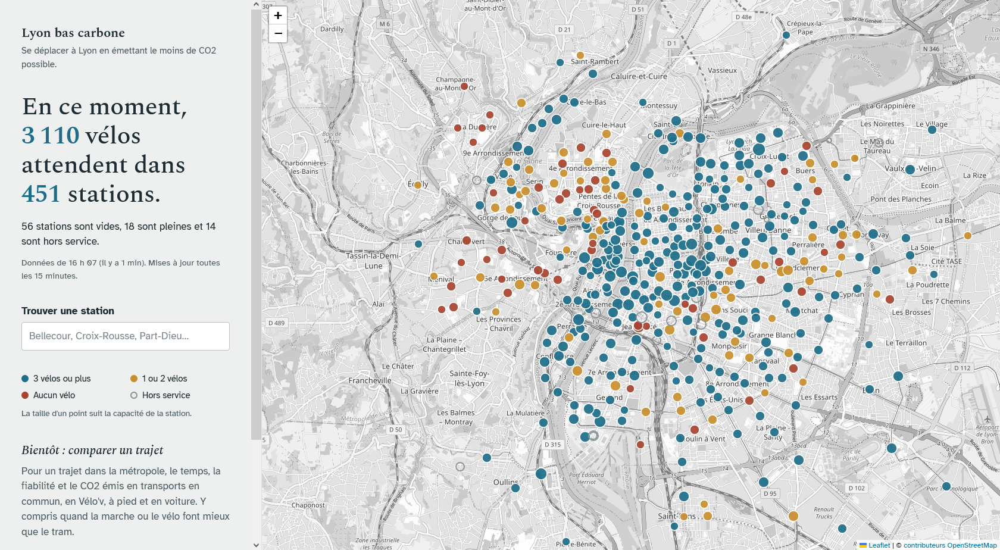
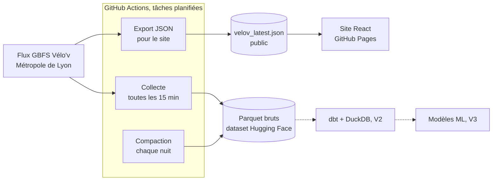

# Lyon bas carbone

[](https://github.com/Kevynflrs/lyon-bas-carbone/actions/workflows/ci.yml)
[](https://github.com/Kevynflrs/lyon-bas-carbone/actions/workflows/collect_velov.yml)
[](https://github.com/Kevynflrs/lyon-bas-carbone/actions/workflows/deploy.yml)
[](LICENSE)

Le projet est né d’un constat d’usager : l’application TCL m’indique quand passe mon tram, mais jamais ce que j’économise en CO2 en le prenant plutôt que la voiture. Lyon bas carbone est un projet personnel de Data Engineering et de Data Science. Un pipeline Python, orchestré par GitHub Actions, collecte toutes les 15 minutes l’état des 460 stations Vélo’v, l’historise en Parquet sur Hugging Face et compacte les fichiers chaque nuit. Le code passe par deux environnements : des tests d’intégration sur le vrai flux de données, avec un dataset de staging, puis un smoke test avant chaque mise en production. Ces tests ont déjà révélé deux anomalies réelles dans les données ouvertes. Un site React publié sur GitHub Pages affiche les disponibilités en direct. Les prochaines étapes : un comparateur CO2 des trajets (TCL, vélo, marche, voiture), des transformations dbt + DuckDB, et un modèle qui prédit la disponibilité des stations à une heure. L’ensemble tourne gratuitement, sans aucun serveur.


Pour un trajet dans la métropole de Lyon, comparer **transports en commun, Vélo'v, marche et voiture**
selon le temps, la fiabilité et le CO2 émis. Avec une méthodologie transparente, y compris quand
le vélo ou la marche font mieux que le tram.

**[Voir la démo](https://kevynflrs.github.io/lyon-bas-carbone/)** · **[Données collectées](https://huggingface.co/datasets/Kevynflrs/lyon-bas-carbone-data)**



Projet de portfolio **Data Engineering + Data Science** : pipeline de données automatisé, contrôles
qualité, CI/CD à deux environnements, site web statique. **100 % gratuit, aucun serveur.**

> Projet indépendant, sans lien avec la Métropole de Lyon, SYTRAL Mobilités, Keolis ou JCDecaux.
> « TCL » et « Vélo'v » sont des marques de leurs titulaires, citées de façon descriptive.

## Où en est le projet

| Brique                                                                            | État         |
| --------------------------------------------------------------------------------- | ------------- |
| Collecte Vélo'v toutes les 15 min, historisée en Parquet                        | en production |
| Compaction quotidienne des fichiers                                               | en production |
| Site web : disponibilités en direct, recherche de station                        | en ligne      |
| CI/CD : tests d'intégration sur `dev`, smoke test et déploiement sur `main` | ok            |
| Comparateur de trajets (temps, CO2)                                               | V1, en cours  |
| Transformations dbt + DuckDB                                                      | V2            |
| Prédiction de disponibilité à H+1                                              | V3            |
| Réentraînement planifié, suivi de dérive                                      | V4            |

## Architecture

Python fait tout le travail en tâches planifiées ; le site se contente de lire des fichiers déjà calculés.
Rien ne tourne en continu, donc rien ne se met en veille.



| Besoin               | Outil                                            | Pourquoi ce choix                                                   |
| -------------------- | ------------------------------------------------ | ------------------------------------------------------------------- |
| Orchestration        | GitHub Actions                                   | Crons gratuits pour un dépôt public, déjà intégrés à la CI   |
| Stockage brut        | Dataset Hugging Face (Parquet,)                  | Stockage public gratuit, versionné, lisible directement par DuckDB |
| Front                | React + TypeScript (Vite), Tailwind CSS, Leaflet | Site statique sur GitHub Pages : toujours en ligne, aucun serveur   |
| Qualité du code     | ruff, pytest, oxlint                             | Lint et tests à chaque push                                        |
| Transformations (V2) | dbt + DuckDB                                     | Moteur analytique local, aucun entrepôt à payer                   |
| ML (V3)              | LightGBM, scikit-learn                           | Données tabulaires et temporelles                                  |

### Choix de conception

- **Petits fichiers et compaction.** Une collecte toutes les 15 minutes produit environ 35 000 fichiers
  par an. Chaque nuit, les quelque 96 fichiers de la veille sont fusionnés en un seul, de façon
  idempotente : moins de fichiers à lister, des lectures DuckDB beaucoup plus rapides.
- **Horodatage en UTC** dans les données brutes ; la conversion en heure de Paris se fera en aval.
- **Données brutes fidèles à la source.** Les anomalies sont signalées dans les logs et filtrées en
  aval, jamais supprimées à la collecte.
- **Aucun secret dans le code** : `.env` en local, GitHub Secrets en CI.

## CI/CD : deux environnements

| Workflow              | Déclencheur                       | Rôle                                                                                         |
| --------------------- | ---------------------------------- | --------------------------------------------------------------------------------------------- |
| `ci.yml`            | push et PR sur `dev` et `main` | Lint, tests unitaires sans réseau, build du site                                             |
| `integration.yml`   | push sur `dev`, PR vers `main` | Vrai flux Vélo'v, écriture et relecture sur un dataset de staging, pipeline de bout en bout |
| `deploy.yml`        | fusion sur `main`                | Smoke test en production, puis déploiement du site                                           |
| `collect_velov.yml` | toutes les 15 min                  | Collecte + export JSON du site                                                                |
| `daily.yml`         | chaque nuit                        | Référentiel des stations, compaction, keepalive des crons                                   |

`main` est protégée par un ruleset : pas de push direct, une Pull Request dont les vérifications
passent est obligatoire. Les tests d'intégration refusent de s'exécuter si le dataset de staging est
celui de production.

## Qualité des données

Les tests d'intégration tournent sur le **vrai** flux. Ils ont déjà révélé deux anomalies réelles :

| Anomalie trouvée                                                                                                      | Traitement                                                                                    |
| ---------------------------------------------------------------------------------------------------------------------- | --------------------------------------------------------------------------------------------- |
| Une station publiée aux coordonnées **(0, 0)**, dans le golfe de Guinée : position inconnue côté producteur | Coordonnées converties en valeurs manquantes à la collecte, station signalée dans les logs |
| Une station **« PLATINE PLAISIR »** située à Plaisir (Yvelines), à 400 km de Lyon, probablement technique   | Conservée dans les données brutes, signalée, exclue du site                                |

Le test d'intégration tolère quelques stations de ce type mais échoue si plus de 2 % des stations
sortent de la métropole, ce qui révélerait un flux cassé (latitude et longitude inversées, mauvaise
ville). Autres contrôles : unicité des stations, compteurs positifs, fraîcheur du flux (moins d'une heure).

## Démarrer en local

Prérequis : Python 3.12 (64 bits), Node.js 20.19+ ou 22.12+.

```bash
git clone https://github.com/Kevynflrs/lyon-bas-carbone.git
cd lyon-bas-carbone

# Pipeline Python
python -m venv .venv
source .venv/bin/activate # Windows : .venv\Scripts\Activate.ps1
pip install -r requirements-dev.txt
pytest -q  # tests unitaires, sans réseau
pytest -m integration # tests sur le vrai flux Vélo'v
python -m pipeline.ingest.velov status --local # collecte réelle dans ./data
python -m pipeline.export.snapshot --local # JSON du site dans ./data/public

# Site web
cd web
npm install
npm run dev # http://localhost:5173
```

Pour écrire sur Hugging Face, copier `.env.example` en `.env` et renseigner `HF_TOKEN` et `HF_DATASET_REPO`.

## Organisation du code

```
pipeline/
  ingest/gbfs.py -parsing GBFS 2.x et 3.0 (fonctions pures)
  ingest/velov.py -collecte Vélo'v vers Parquet, contrôles de zone
  ingest/compact.py -fusion quotidienne des petits fichiers
  export/snapshot.py -JSON public lu par le site
  storage.py -écriture Hugging Face ou locale
tests/ -tests unitaires (sans réseau)
tests/integration/ -tests sur le vrai flux et le dataset de staging
web/ -site React + TypeScript (Vite, Tailwind CSS, Leaflet)
.github/workflows/ -CI, intégration, déploiement, collecte, tâches quotidiennes
```

## Conventions de développement

### Branches

Chaque modification passe par une branche dédiée, puis par une Pull Request : d'abord vers `dev`
(CI + tests d'intégration), puis de `dev` vers `main` (déploiement en production).

| Préfixe      | Usage                                                   | Exemple                                 |
| ------------- | ------------------------------------------------------- | --------------------------------------- |
| `feature/`  | nouvelle fonctionnalité                                | `feature/pipeline`, `feature/front` |
| `test/`     | ajout ou correction de tests                            | `test/pipeline`                       |
| `docs/`     | documentation                                           | `docs/readme`                         |
| `refactor/` | réorganisation du code sans changement de comportement | `refactor/ruff`                       |

### Messages de commit

Les commits suivent la convention [Conventional Commits](https://www.conventionalcommits.org/fr/) :
`type: description courte`, à l'impératif.

| Type         | Usage                                           | Exemple tiré de l'historique                                                     |
| ------------ | ----------------------------------------------- | --------------------------------------------------------------------------------- |
| `feat`     | nouvelle fonctionnalité                        | `feat: Implement GBFS parsing for version 2.x and 3.0`                          |
| `fix`      | correction de bug                               | `fix: Enhance station information parsing and add quality checks for locations` |
| `test`     | tests                                           | `test: Add integration tests for Vélo'v and Hugging Face dataset interactions` |
| `ci`       | workflows GitHub Actions                        | `ci: Add integration workflow for staging environment`                          |
| `refactor` | restructuration sans changement de comportement | `refactor: Organize imports … with ruff`                                       |
| `docs`     | documentation                                   | `docs: add capture image for documentation`                                     |
| `chore`    | configuration, maintenance                      | `chore: Update pytest configuration to exclude integration tests`               |

Les types permettent de lire l'historique d'un coup d'œil et de générer plus tard un changelog automatiquement.

## Feuille de route

- [X] **V0, socle** : collecte, compaction, CI/CD à deux environnements, site des disponibilités
- [ ] **V1, comparateur CO2** : GTFS TCL, matrice de trajets, facteurs d'émission ADEME
- [ ] **V2, pipeline analytique** : dbt + DuckDB, météo, tests de qualité dbt, dashboard
- [ ] **V3, machine learning** : disponibilité Vélo'v à H+1, comparée à des baselines
- [ ] **V4, MLOps** : réentraînement planifié, suivi de dérive (Evidently)

## Données et licences

| Donnée                        | Producteur                    | Licence             |
| ------------------------------ | ----------------------------- | ------------------- |
| Disponibilités Vélo'v (GBFS) | Métropole de Lyon / JCDecaux | Licence Ouverte 2.0 |
| Fond de carte                  | Contributeurs OpenStreetMap   | ODbL                |
| Horaires TCL (GTFS), V1        | SYTRAL Mobilités             | Licence Mobilités  |
| Facteurs d'émission, V1       | ADEME (Impact CO2)            | Voir impactco2.fr   |

Le code est distribué sous licence [MIT](LICENSE). Les données restent soumises à leurs licences
respectives, indiquées dans le tableau ci-dessus.
